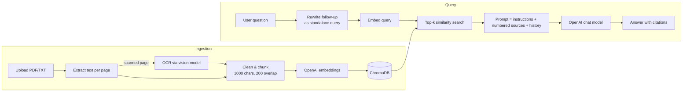

# 🔬 Smart AI Research Assistant

A full-stack AI application that lets you upload research documents, build a searchable knowledge
base, run semantic search, and chat with your documents. Answers are generated with
**Retrieval-Augmented Generation (RAG)** and cite the exact source and page they came from.

## Problem

Students, researchers and professionals spend hours reading documents, searching for information
and summarizing reports by hand. Keyword search has no contextual understanding and cannot answer
questions across a large collection of documents.

## Features

| Feature | Where |
|---|---|
| Document upload & processing (PDF, TXT, MD) | Knowledge Base |
| OCR for scanned PDFs (AI vision) | Knowledge Base |
| Vector database integration (ChromaDB) | Knowledge Base |
| Knowledge base management (list / delete documents) | Knowledge Base |
| PDF chat with RAG, multi-document Q&A | Chat with Documents |
| Citation-based responses (source + page) | Chat with Documents |
| Context-aware follow-up questions | Chat with Documents |
| Conversation export to Markdown | Chat with Documents |
| Semantic search engine with relevance scores | Semantic Search |
| Research summary generator | Summaries & Insights |
| AI-powered cross-document insight generation | Summaries & Insights |
| Cloud deployment | Streamlit Community Cloud |

## Tech stack

- **Language:** Python 3.11+
- **Frontend:** Streamlit
- **LLM:** OpenAI Chat Completions API (default `gpt-4o-mini`, configurable)
- **Embeddings:** OpenAI `text-embedding-3-small`
- **Vector database:** ChromaDB (persistent, cosine similarity)
- **Document processing:** pypdf (the maintained successor of PyPDF2), pypdfium2 for page rendering
- **OCR:** OpenAI vision (same chat model) for scanned pages
- **Deployment:** Streamlit Community Cloud

## Architecture



See [docs/RAG_PIPELINE.md](docs/RAG_PIPELINE.md) for a detailed description of each stage.

## Project structure

```
├── app.py                      # Streamlit entry point & navigation
├── views/                      # One file per page
│   ├── home.py
│   ├── knowledge_base.py
│   ├── chat.py
│   ├── search.py
│   └── insights.py
├── research_assistant/         # Core logic (UI-independent)
│   ├── config.py               # Settings from .env / Streamlit secrets
│   ├── ingestion.py            # Text extraction & chunking
│   ├── openai_client.py        # Embeddings & chat calls
│   ├── vector_store.py         # ChromaDB wrapper
│   ├── rag.py                  # RAG pipeline
│   ├── summarizer.py           # Summaries & insights (map-reduce)
│   └── ui.py                   # Shared Streamlit helpers
├── tests/                      # Unit tests
├── data/sample_docs/           # Sample documents for the demo
├── docs/                       # Technical documentation
└── deliverables/               # Report, presentation, video script
```

## Getting started

```bash
python -m venv .venv
.venv\Scripts\activate          # Windows  (macOS/Linux: source .venv/bin/activate)
pip install -r requirements.txt
copy .env.example .env          # then put your OpenAI key in .env
streamlit run app.py
```

Run the tests:

```bash
python -m pytest
```

## Configuration

All settings can be set in `.env` (local) or in the app's **Secrets** (Streamlit Cloud):

| Variable | Default | Purpose |
|---|---|---|
| `OPENAI_API_KEY` | — | Required |
| `OPENAI_CHAT_MODEL` | `gpt-4o-mini` | Model used for answers & summaries |
| `OPENAI_EMBEDDING_MODEL` | `text-embedding-3-small` | Embedding model |
| `CHUNK_SIZE` / `CHUNK_OVERLAP` | `1000` / `200` | Chunking in characters |
| `TOP_K` | `5` | Chunks retrieved per question |

## Deployment (Streamlit Community Cloud)

1. Push this repository to GitHub.
2. On share.streamlit.io, create a new app pointing at `app.py`.
3. Under **Settings → Secrets**, add `OPENAI_API_KEY = "sk-..."`.
4. Deploy. Note: the free tier's disk is ephemeral, so uploaded documents reset when the app restarts.
